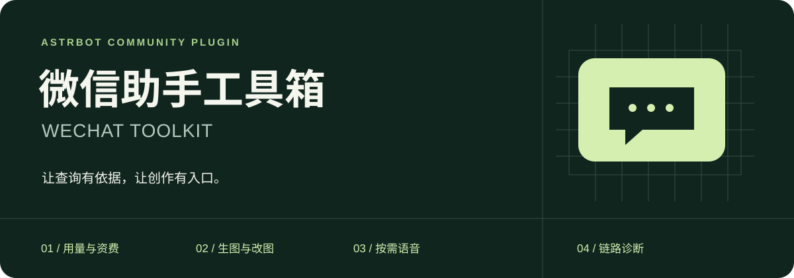
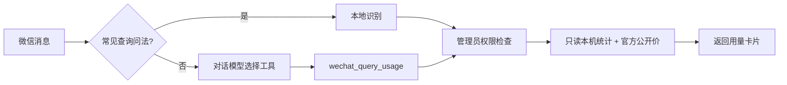

<div align="center">



**在微信里查用量、画图片、发语音，知道每次等待花在哪里。**

[](https://github.com/AstrBotDevs/AstrBot)
[](CHANGELOG.md)
[](https://docs.astrbot.app/platform/weixin_oc.html)
[](LICENSE)

[快速开始](#快速开始) · [能力一览](#能力一览) · [生图配置](#生图配置) · [资费口径](#资费口径) · [常见问题](#常见问题)

</div>

## 能力一览

| 能力 | 你可以这样说 | 实际行为 |
| --- | --- | --- |
| 📊 用量 | `用量` / `今天花了多少钱？` | 只读当前机器人统计，显示今日与累计任务、Token、人民币估算 |
| 🧭 自然语言 | “这个助手从开始到现在花了多少？” | 模型选择 `wechat_query_usage` 工具查询真实数据 |
| 💰 官方资费 | `资费` / `刷新资费` | 同步火山官方公开价格，显示来源和缓存时间 |
| 🧩 模型 | `生图模型` / `刷新生图模型` / `生图模型 flare` | 从当前服务发现模型、查看和切换默认模型 |
| 🎨 文生图 | `生图 一只戴围巾的橘猫，水彩风格` | 调用你配置的 OpenAI 兼容生图接口，返回图片 |
| 🖌️ 改图 | 发图并说 `改图 把背景换成雪山，保留人物` | 用本条消息中的1～4张图片编辑；无图时使用本会话上一张生成图 |
| 🔊 按需语音 | `语音 你好，很高兴认识你` | 调用已配置TTS，发送可播放音频文件 |
| ⏱️ 耗时诊断 | `耗时` / `测速` | 查看最近完成消息的模型、工具和微信发送时间 |

> 所有指令和模型工具仅允许 **个人微信管理员** 使用。
> 这里的“余额/额度”返回的是本机用量卡片；插件没有账户真实余额数据。音频以文件发送，不是原生语音气泡。

## 快速开始

**1. 安装插件**

AstrBot → 插件 → 安装插件 → 从链接安装：

```text
https://github.com/PuerJJJ/astrbot_plugin_wechat_toolkit
```

**2. 配置管理员**

在AstrBot中将自己的微信ID设为管理员。当前兼容 `>=4.29.3,<4.30`，只声明 `weixin_oc` 支持。Python 3.10+；使用AstrBot自带的 aiohttp、Pillow，不额外安装SDK。

**3. 按需开启能力**

- 用量查询默认可用；官方价格在启动时和每24小时尝试同步，也可手动刷新。
- 语音：在插件配置中选择已添加的TTS提供商，无需开启“所有回复自动TTS”。
- 生图：填写基础地址、API Key，开启开关。
- 诊断：默认关闭，开启后重载插件。

先发送 `用量`，再测试你需要的功能。复杂自然语言还需要支持函数调用的对话模型，以及允许使用这些工具的人格。

## 自然语言怎么工作



`wechat_query_usage` 是 `main.py` 通过 AstrBot 注册的函数，不是需要单独安装的服务。常见短句走本地规则；复杂说法由模型理解工具说明后调用。模型选择不能保证覆盖所有表达。

“银行卡余额”“余额是什么意思”“写一个查询余额的SQL”等不直接拦截。工具自身也会检查管理员权限，模型无法绕过。

## 模型与尺寸

常见兼容模型为 `gpt-image-2`、`gpt-image-2.5-sunburst`、`gpt-image-2.5-flare`。列表由你的服务端和密钥权限决定，不能据此保证每个模型都支持同样的质量、透明背景和编辑功能。

```text
生图模型
刷新生图模型
生图模型 flare
生图 --model gpt-image-2 --size 16:9 --quality high 一座山间小屋
改图 --model sunburst --size 3:4 保留主体，把背景改为森林
```

`GET /models` 使用与生图相同的基础地址和密钥，结果按服务/密钥隔离缓存24小时。接口不支持或读取失败时明确标记预设/手填候选，不能伪装成发现成功。`--model`仅影响本次，`生图模型 ID`修改默认值。支持`sunburst`、`flare`、`gpt2`短名。

| 比例 | 实际像素 | 比例 | 实际像素 |
| --- | --- | --- | --- |
| 1:1 | 1024×1024 | 16:9 | 1536×864 |
| 9:16 | 864×1536 | 3:4 | 960×1280 |
| 4:3 | 1280×960 | 3:2 | 1536×1024 |
| 2:3 | 1024×1536 | 2:1 | 1536×768 |
| 1:2 | 768×1536 | auto | 服务端选择 |

以上预设与自定义像素尺寸均可用于生图和改图。直接指令的参数放在提示词前，具体文字保持原样；自然语言请求也可让模型填写`model/size/quality`工具参数。

## 生图配置

在 **插件 → 微信助手工具箱 → 配置 → 生图与改图** 中设置：

| 配置 | 默认值 | 说明 |
| --- | --- | --- |
| 启用生图 | 关闭 | 配好后开启 |
| API基础地址 | 空，由你填写 | 包含 `/v1`，不要追加 `/images/generations`；支持HTTPS |
| API Key | 空 | 页面密码字段；只存本机配置，不写入仓库 |
| 模型 | `gpt-image-2.5-sunburst` | 可改为Flare、GPT Image 2或兼容服务支持的模型 |
| 默认质量 | `low` | 测试低成本；最终作品可选medium/high；xhigh/max需2.5模型 |
| 文生图尺寸 | `1024x1024` | 也支持auto或合法自定义尺寸 |
| 改图尺寸 | `auto` | 根据参考图选择 |
| 格式 / 背景 | `png` / `auto` | 透明背景需2.5模型和PNG/WebP |
| 总超时 | 420秒 | 可配置180～600秒 |

**接口约定**

- 文生图：`POST /images/generations`，JSON请求。
- 改图：`POST /images/edits`，multipart `image[]`。
- 只接受响应中的 `data[0].b64_json`，不下载接口返回的任意URL。通常无需发送response_format；部分兼容服务要求时可开启该配置。
- 参考图为PNG/JPEG/WebP，每张≤10MB，最多4张；输出解码后验证格式及像素。
- 自定义尺寸两边须为16的倍数，每边≤3840，比例1:3～3:1，总像素655360～8294400。
- 默认失败后重试3次（首次+3次，共最多4次），每次尝试及失败后向微信发送进度；可配置0～3次重试。限流、5xx、网络异常和超时会重试；参数错误、401/403等直接提示修正。超时后服务端可能仍在生成，重试可能产生额外计费。
- 重试只针对生成/编辑请求。图片已生成后发送失败不会再次生成。自然语言生图工具使用AstrBot内置后台任务机制，避免普通工具120秒超时中断长任务。
- 编辑不会覆盖原图。生成图保存在插件数据的 `images/` 下；每个会话只记住自己的上一张图。图片文件不会自动删除，请按自己的保留策略清理。

也可自然语言让模型调用 `wechat_generate_image`，指定质量和尺寸。模型不能通过工具参数更改API地址、密钥或读取任意服务器文件。

> 生图功能不是“免费生图”：费用由你配置的服务商收取。接口模拟测试不能代替你自己服务地址的真实验收。

## 资费口径

### 自动获取，价格数字不写死

价格来源是[火山官方公开价格文档](https://ark.volcengine.com/region:cn-beijing/docs/model-pricing.md)。插件从表格解析当前高峰/空闲单价和时间段，缓存来源、抓取时间及文档哈希。

目前自动解析 **DeepSeek V4.1 Flash 标准版和经济版** 的常规在线推理价格。只对确认直连 `ark.cn-beijing.volces.com` 的对应Provider估算。其他模型、转发服务、低优/低延迟等计费模式不自动套用这些单价。

| 场景 | 显示与处理 |
| --- | --- |
| 同步成功 | 显示来源更新时间，使用当前公开价估算 |
| 同步失败，有缓存 | 保留上次有效价格并提示旧缓存 |
| 没有价格 / 模型不支持 | 金额显示未知，不按0元计算 |
| 文档结构或计费单位改变 | 拒绝猜测，保留旧缓存并提示 |

### 它不等于账单

- 只统计当前机器人ID下的数据；调用次数 = **已完成的对话任务数**，一个任务可能多次请求模型。
- Token包括各轮重复输入、缓存及推理输出；统计按北京时间划分日期。
- 历史用量按**当前公开价**估算，不是历史实扣账单；任务跨高峰/空闲时段时采用完成时刻，因此存在估算误差。
- 不包含搜索、图片、TTS/STT、Embedding、记忆总结等独立调用及优惠抵扣；失败/未完成任务的可能费用也不包含。
- 不把累计消费当余额，不猜测充值额或剩余额度。

火山另有 [GetModelActivation](https://ark.volcengine.com/region:cn-beijing/docs/get-model-activation-api.md) 管理API，`WithPrice=true` 可取得账户计价信息，但需要AK/SK；推理API Key不适用。当前版本使用公开价，不接收管理AK/SK，不承诺账户合同折扣或真实余额。

## 多机器人与解析器兼容

用量查询根据触发消息的机器人ID过滤统计数据；管理员在机器人A查询只得到A的数据，在B查询只得到B的数据。不会因为两个机器人使用相同模型、API Key或管理员角色而合并。

卡片只显示今日、累计和“消费（估算）”，详细统计范围在本README说明。“资费”仍可查看价格来源和时间。

`flatten_weixin_forwards` 默认开启：将个人微信不支持的`Nodes/Node`合并转发拆成按顺序发送的普通组件，便于配合独立的[Zhalslar/parser](https://github.com/Zhalslar/astrbot_plugin_parser)插件发送图集和卡片。只包装个人微信适配器，不修改parser源码；停用工具箱时兼容层也会移除。转发最多8层、100个普通组件。

### 原画质视频发送

配置 `download_base_url` 为你自己的 AstrBot 公网 HTTPS 入口（例如 `https://bot.example.com`）。启用 `large_video_links` 后：

- 默认 **20 MB 以内**原样发送视频；`direct_video_max_mb` 可调整阈值。
- 超过阈值发送**原文件下载链接**，不压缩、不降分辨率。解析源返回什么画质，就保留什么画质。
- 链接默认 **1 小时有效**，`download_link_ttl` 可调整为 5 分钟至 24 小时，支持重复访问及 Range 续传。
- 下载使用 AstrBot 内置单文件随机令牌服务。持有链接者可以下载，请勿转发私人视频链接。实例重启会使已有令牌提前失效。
- 文件副本保存在 `downloads/`，到期自动清理；解析器原缓存不改写。未配置下载入口时继续直接发送原文件。

### 每轮费用尾注

开启 `turn_usage_footer`，个人微信回复末尾会增加一行（示例）：

```text
本次对话模型：12,345 Token · 约¥0.0021
```

汇总同一轮 Agent 的多次模型调用，包含输入、缓存输入与输出 Token，不另发请求让模型估算。各消息独立计数，不混合不同机器人或联系人。纯指令未调用模型时显示 0 Token；服务未返回用量或模型费率未知时明确显示未知。

金额是支持模型公开单价的估算，**只含本轮对话模型**，不含生图、TTS、Embedding、独立记忆总结等费用。公共安装默认关闭，可在配置开启；它不改变用量卡片的统计口径。

此处是正常功能路径的数据隔离。AstrBot全局管理员仍可拥有实例级管理与文件/代码权限；共享实例不是互不信任用户之间的安全隔离环境。

## 语音与诊断

TTS通过 `tts_provider_id` 选择，留空使用当前会话默认TTS。已验证MiMo WAV；其他提供商和格式需实际验收。指令最多600字，模型工具名为 `wechat_send_voice`。

诊断开启后记录排队、模型请求、工具调用和微信发送接口耗时。模型细分目前只覆盖OpenAI Responses提供商。微信API返回不代表手机已显示/已读，入站时间戳差受时钟影响，工具时长可能重叠。

诊断包装本版本内部方法，版本兼容范围刻意限制为4.29.x，升级前请验证；停用时恢复仍由插件包装的方法。

## 数据与隐私

| 数据 | 位置 | 内容 |
| --- | --- | --- |
| 插件配置 | `data/config/astrbot_plugin_wechat_toolkit_config.json` | API地址与密钥、开关等；AstrBot密码框仅遮罩显示 |
| 诊断库 | `data/plugin_data/astrbot_plugin_wechat_toolkit/latency.db` | 最近2000条数字时延、工具名、错误类型、会话哈希 |
| 价格缓存 | 同目录 `ark-public-prices.json` | 官方公开价格、来源与更新时间 |
| 图片 | 同目录 `images/`、`last-images.json` | 生成图及按会话隔离的上一张图索引 |

不记录密钥、模型正文或工具参数到诊断库。生图提示词与选定参考图会发给你配置的生图服务；返回图片提交微信。诊断数值也进入AstrBot日志，其保留期由AstrBot管理。

LivingMemory和链接解析器是独立插件，不随本项目安装。

## 可搭配的提示词资源

[yang0/handraw-style](https://github.com/yang0/handraw-style) 提供画风、图型、配色和参考图，可作为生图前的设计与提示词层。建议按需选取资源，遵循其模型能力判断和参考图隔离规则，而不是把整库塞进每轮聊天。本插件不内置、重新分发该项目或私人画风，也不会自动上传作品到社区。

它主要帮助提高风格描述和版式的一致性，不能保证每张图片都更好。实际使用需要模型、工具及参考图传递能力配合；资源许可与署名要求以原项目为准。原作者：**yang0**。

## 常见问题

<details>
<summary><strong>为什么说“余额”却返回用量？</strong></summary>

本插件只有当前机器人的调用统计和公开单价，没有账户余额接口权限。卡片会说明统计范围，避免把估算费用当真实余额。
</details>

<details>
<summary><strong>为什么语音是文件？</strong></summary>

当前个人微信适配器不支持发送原生语音气泡。[官方支持表](https://docs.astrbot.app/platform/weixin_oc.html)。
</details>

<details>
<summary><strong>改图没带图片，可以继续改上一张吗？</strong></summary>

可以，默认使用当前会话上一张成功生成图；不会拿另一个会话的图片。新结果另存文件。
</details>

<details>
<summary><strong>从旧名称如何迁移？</strong></summary>

旧名为 `astrbot_plugin_han_assistant`。先停用旧插件，再备份并迁移配置和plugin_data目录至新名称；不要同时启用。工具统一为wechat前缀。
</details>

## 开发与验证

```sh
python -m unittest discover -p 'test_*.py' -v
```

测试使用临时数据库、模拟HTTP及合成图片，不调用付费生图服务。安装插件后可在AstrBot根目录运行：

```sh
PYTHONPATH=. python data/plugins/astrbot_plugin_wechat_toolkit/runtime_checks.py
```

欢迎提交明确的复现步骤、AstrBot版本、平台类型和脱敏日志。请勿上传API Key、原始配置或聊天数据库。

---

<div align="center">
MIT · 社区开发 · 与腾讯、火山引擎及任何模型服务商无官方隶属关系
</div>
